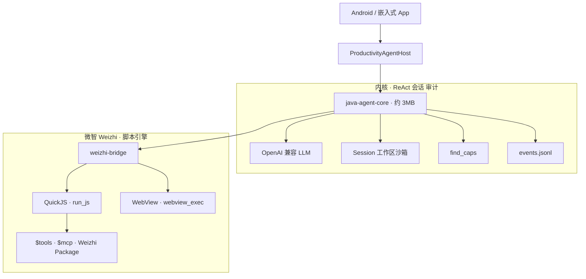

<p align="center">
  
</p>

<h1 align="center">Agent1</h1>

<p align="center">
  <strong>给低端设备的开箱即用智能体。</strong><br />
  <em>A compact coding agent for Android &amp; embedded JVM hosts.</em>
</p>

<p align="center">
  约 <strong>3MB</strong> 的内核装下 ReAct 会话、工作区沙箱、工具循环与 JSONL 审计；<br />
  模型写 <strong>JavaScript</strong>（<code>run_js</code>）编排任务，能力靠 <code>find_caps</code> 按需检索 —— 数十万条能力，上下文里只留几条。
</p>

<p align="center">
  <a href="https://fengshihao.github.io/agent1/">
    
  </a>
  <a href="https://github.com/fengshihao/agent1/actions/workflows/ci.yml">
    
  </a>
  
  
  
  <a href="LICENSE">
    
  </a>
</p>

<p align="center">
  <a href="https://fengshihao.github.io/agent1/">官网</a> ·
  <a href="#quick">快速开始</a> ·
  <a href="#arch">架构</a> ·
  <a href="#caps">能力</a> ·
  <a href="#integrate">一句话集成</a> ·
  <a href="CONTRIBUTING.md">贡献</a> ·
  <a href="AGENTS.md">AGENTS（给 AI）</a> ·
  <a href="#en">English</a>
</p>

---

## 为什么是 Agent1

| | |
| --- | --- |
| 🪶 **够小** | `java-agent-core` 约 **3MB**，ReAct、会话、工作区、审计一个不缺，可与业务 APK 同包分发 |
| 🧩 **可嵌入** | 宿主接入 `ProductivityAgentHost` + 模型 Key，即得完整生产力循环，不是只能在别人 App 里聊天 |
| ⌨️ **编程型** | 主路径是写 JavaScript（QuickJS / `run_js`）编排任务，而不是几十个工具名塞进系统提示 |
| 🔎 **靠检索** | Skill、脚本、平台 API、MCP 进同一套本地索引，`find_caps` 只带回短摘要，目录再大也不撑上下文 |
| 🛠️ **能干活** | 读写工作区、拉网页、跑脚本、调 WebView、接 MCP，面向真实的文档、表格、流程类工作 |
| 🧬 **可进化** | 走通的流程沉淀成 Skill 并晋升 `shared/local`，官方 JS 包执行前按需安装，`events.jsonl` 全链路审计 |

> 桌面生产力 CLI（`./agent1`）与 Android 生产力 App 共用同一内核，能力对照见 [doc/CLI与Android-Agent能力对照.md](doc/CLI与Android-Agent能力对照.md)。

<a id="quick"></a>

## 快速开始

**1 · 配置模型 Key**

```bash
export DASHSCOPE_API_KEY="your-key"   # 或 ALIBABA_API_KEY / OPENAI_API_KEY / QWEN_API_KEY
```

**2 · Android App（推荐路径）**

```bash
./publish-java-agent-core.sh      # 发布 java-agent-core 到本地 Maven
./build-android-agent.sh          # Debug 构建，需 adb；Release 加 --release
```

App 内即见 **生产力助手**：`ProductivityAgentHost` + 会话列表 / 流式聊天 / 模型设置（参考 `android_agent` 分层实现）。

**3 · 桌面联调（macOS / Ubuntu；Web UI 亦支持 Windows）**

```bash
./agent1                  # 生产力助手 · 交互
./agent1 ui               # 本机 Web UI（浏览器，风格对齐 Android）
./agent1 ui --no-browser  # 仅起 HTTP 服务，不打开浏览器（WebView 薄壳联调见 desktop_shell/README.md）
./agent1 你好             # 单次提问
./agent1 models           # 模型与运行时参数
./agent1 tools            # 当前平台工具能力摘要
./agent1 logs failed      # 查 events.jsonl
```

Web UI 规划与 API：[doc/规划/CLI-Web-UI-MVP.md](doc/规划/CLI-Web-UI-MVP.md)。改前端：`cd java_agent/web_ui && npm ci && npm run build`（产物进 `cli` 资源；`AGENT1_SKIP_WEB_UI=1` 可跳过 Gradle `buildWebUi`）。

**4 · 检查（与 CI 同源，PR 前必跑）**

```bash
./java_agent/gradlew -p java_agent :core:test :cli:test
./scripts/ci-local.sh fast        # 日常 PR 门禁
./scripts/ci-local.sh full        # 含 Android assemble（需 ANDROID_HOME）
```

CI 在 [`.github/workflows/ci.yml`](.github/workflows/ci.yml)：`java-test`、`quality-static`、`android-assemble-debug`。
官网 [fengshihao.github.io/agent1](https://fengshihao.github.io/agent1/) 推到 `master` 后由 Pages 发布，本地预览 `./scripts/serve-site.sh`。

<details>
<summary><strong>环境变量（摘要）</strong></summary>

| 变量 | 说明 |
|------|------|
| `DASHSCOPE_API_KEY` / `ALIBABA_API_KEY` / `OPENAI_API_KEY` | 模型 API Key |
| `ALIBABA_BASE_URL` / `OPENAI_BASE_URL` | OpenAI 兼容基地址 |
| `AGENT1_AGENT_ROOT` | 会话与日志数据根（桌面生产力路径） |
| `AGENT1_SCRIPT_TIMEOUT_MS` 等 | 脚本与运行时限额，见 `AgentRuntimeDefaults` |

运行时数据目录：[桌面生产力](java_agent/doc/runtime-data-layout.md) · [Android App](android_agent/doc/runtime-data-layout.md)。

</details>

<a id="arch"></a>

## 架构



想深入内核 ReAct 循环、桌面 / Android 双宿主链路与 run_js 脚本环,见 [架构与主流程教程](doc/架构教程.md)(含流程图与时序图)。

```text
agent1/
├── agent_core/              # java-agent-core（~3MB 量级运行时）
├── java_agent/              # CLI + Gradle + weizhi-bridge
├── android_agent/           # 嵌入式宿主参考 App（Compose + 生产力助手）
├── doc/                     # 能力对照、集成、规划
├── docs/ai/                 # 编码智能体开工文档
├── site/                    # 官网（GitHub Pages）
└── AGENTS.md
```

<a id="caps"></a>

## 能力一览

**内核工具**（不依赖 Weizhi 亦有）：`read_file` · `write_file` · `edit_file` · `list_dir` · `read_url` · `chat_history` · `find_caps` · `ask_user` · `promote_request` · `todo_write` 等。
官方 JS 包不是模型工具：`run_js` 里写 `import … from "weizhi:<name>"`，宿主在执行前安装。

<details>
<summary><strong>集成 Weizhi 后的扩展环</strong></summary>

| 类别 | 说明 |
|------|------|
| **JS / 脚本** | `run_js`、QuickJS、`$tools` / `$mcp` 桥、workspace 内多文件工程 |
| **检索** | `find_caps` — 按关键词查 Skill、文档、MCP 工具摘要等 |
| **Skill** | `load_skill` + workspace / assets 下的 SKILL.md |
| **MCP** | `mcp_servers.json` + 脚本内 MCP 调用 |
| **WebView** | `webview_exec`（Android WebView / 桌面 Chromium） |
| **工作区增强** | `grep` · `glob` · `zip` · 白名单 `bash`；实现在 `agent_core`，集成 Weizhi 时注册 |

Android 启用完整环：联编 `weizhi` 或使用 `weizhi-prebuilt`，见 [android_agent/QUICKSTART.md](android_agent/QUICKSTART.md)。

</details>

<details>
<summary><strong>产品愿景：嵌入式里的「会写脚本的同事」</strong></summary>

1. **用户说人话，助手写 JS**：在 Session `workspace/` 里用一段脚本编排任务（`run_js`），通过 Weizhi QuickJS 调用 `fs`、平台 **Caps**、`import … from "weizhi:<name>"` 的官方包，以及白名单内的 `$tools` 桥。多步工作写在同一段脚本里，而不是一轮轮硬调零散 Java Tool。
2. **工具少而精，细节靠检索**：Java 层只保留工作区 I/O、脚本执行、用户澄清等「内核工具」。具体怎么做 Word、分享、画图、调外部服务，先走 **`find_caps`**：结果里的调用示例可以直接写进脚本。Skill 命中时附上正文。API 手册不打进 APK。
3. **Skill：可加载、可自创、可晋升**：`load_skill` 从 workspace `skills/`、App `assets`（Android）或项目目录（桌面联编）拉取 SKILL.md 工作流；运行中沉淀的可重复流程经总结与 **`promote_request`** 进入 `shared/local/skills/`，供后续 Session 复用（自进化路线见 [doc/规划/自进化Agent/README.md](doc/规划/自进化Agent/README.md)）。
4. **MCP：外接能力而不膨胀内核**：通过 `agentRoot/mcp_servers.json` 配置 MCP Server；索引进入 `find_caps`（kind=mcp），脚本内用 **`$mcp.<server>.<tool>`** 调用，不把每个 MCP 工具都注册成 Java `@Tool`。
5. **WebView：在设备上「看得见」的结果**：Android 系统 WebView + `webview_exec` 渲染脚本页、图表、表单总结（见 `android_agent/doc/webview-draw-e2e.md`）；桌面联调用 Headless Chromium + CDP，协议与 Skill 尽量对齐。网页图走 `find_caps` 的 `web_lib`（按库锁定的 CDN 和薄 HTML 壳，同批壳装在 `shared/catalog/templates/`）：先写 Markdown / Mermaid / JSON，再套壳，`write_file` / `edit_file` 写入 `.html` 后宿主自动用 `webview_exec` 打开检查，失败回到工具回执。
6. **自进化数据面**：Session 隔离的可写沙箱；可复用 Skill 晋升 **shared/local**；官方 Package 在 `run_js` 前按需安装；`events.jsonl` 全链路审计。目标：越用越懂你的流程，而不是每次从零科普工具列表。

更完整的 SDK 集成面见 [doc/规划/Agent1-SDK愿景.md](doc/规划/Agent1-SDK愿景.md)。

</details>

## 依赖：Weizhi（微智）

Agent1 的脚本、设备能力和 WebView 依赖独立开源项目 **[Weizhi / 之谓（常称微智）](https://github.com/fengshihao/weizhi)**：嵌入式 **QuickJS**、沙箱 `fs`、可选 **Caps**（Android 文件、分享、提醒等），以及脚本内的 `mcp.connect`。

<details>
<summary><strong>分工、集成方式与如何带上 Weizhi</strong></summary>

| | **Agent1（`java-agent-core`）** | **Weizhi** |
| --- | --- | --- |
| **定位** | 生产力 **编排层**：ReAct、Session、模型可见的 Java 工具、能力检索、JSONL 审计 | **脚本引擎**：在设备里跑 QuickJS |
| **LLM 可见** | 工作区读写、`grep` / `glob` / `zip` / `bash`、`load_skill`、`run_js`、`webview_exec` | 脚本内 `fs`、`$tools`、`$mcp`、Caps（不是单独的模型工具） |
| **集成方式** | 发布 `java-agent-core` | 源码联编或 Maven AAR；经 `weizhi-bridge` 与 Android `WeizhiHostLoader` 接入 |

**典型分工**：用户描述任务 → Agent1 用 Java 工具改文件、搜索、跑白名单命令、加载 Skill → 需要编排时用 **`run_js`** 交给 Weizhi → 脚本里调 `fs`、Caps、MCP，或 `webview_exec` 出图 → 事件写回 `events.jsonl`。

```bash
./sync-weizhi.sh          # 默认 fengshihao/weizhi → ./weizhi；fork 可设 WEIZHI_GIT_URL
cd android_agent && ./gradlew :app:assembleDebug   # CI 同样先 sync 再 assemble
```

- **无 weizhi 时**：仍可使用工作区读写、`read_url`、`chat_history` 等 **内核工具**（适合极简集成或先接 UI）。
- **有 weizhi 时**：打开脚本、MCP、WebView，并注册 `agent_core` 里的 grep / glob / zip / bash / skill。App 内 `BuildConfig.WEIZHI_INTEGRATED=true`。
- **无 NDK / 无源码**：可用 [`android_agent/weizhi-prebuilt`](android_agent/weizhi-prebuilt/README.md) 导入预编译 Maven（见 QUICKSTART）。

Weizhi 自身文档：[README](https://github.com/fengshihao/weizhi) · [AI 集成指南](https://github.com/fengshihao/weizhi/blob/master/docs/INTEGRATION_FOR_AI.md)；Agent1 侧说明：[doc/集成/WEIZHI.md](doc/集成/WEIZHI.md)。

</details>

<a id="integrate"></a>

## 一句话集成到你的 App

把这段话发给 Cursor、Claude Code 等编码智能体，它会自己克隆、阅读，并把 SDK 接进你的工程：

```text
把开源项目 Agent1（https://github.com/fengshihao/agent1）集成进我的 Android App。
请阅读 README、AGENTS.md，以及 android_agent 里 ProductivityAgentHost 的接法，
用 java-agent-core 接到我现有的界面上。改完告诉我要加哪些依赖、模型 Key 放在哪里。
```

人类入口：[docs/ai/START.md](docs/ai/START.md) 的「准备环境」+「贡献一句」；要求按 [AGENTS.md](AGENTS.md) 与 [docs/ai/CHECKLIST.md](docs/ai/CHECKLIST.md) 完成单测与 `ci-local.sh`。

## 文档地图

| 想了解 | 去看 |
| ------ | ---- |
| 桌面 CLI 与 Android 能力对照 | [doc/CLI与Android-Agent能力对照.md](doc/CLI与Android-Agent能力对照.md) |
| Weizhi（微智）集成细节 | [doc/集成/WEIZHI.md](doc/集成/WEIZHI.md) |
| Android 快速上手 | [android_agent/QUICKSTART.md](android_agent/QUICKSTART.md) |
| 运行时数据目录 | [桌面](java_agent/doc/runtime-data-layout.md) · [Android](android_agent/doc/runtime-data-layout.md) |
| 自进化路线 / SDK 愿景 | [doc/规划/自进化Agent/README.md](doc/规划/自进化Agent/README.md) · [doc/规划/Agent1-SDK愿景.md](doc/规划/Agent1-SDK愿景.md) |
| 无 Android SDK 环境的验证 | [doc/cloud-agent.md](doc/cloud-agent.md) |
| 变更记录 | [CHANGELOG.md](CHANGELOG.md) |

## 贡献与质量门禁

- 一个 PR 一件事；行为变更须 **JUnit / Android 单测**，PR 前跑 `./scripts/ci-local.sh fast`（动 Android 组装链跑 `full`）
- Android 分层规则：[`.cursor/rules/android-layering.mdc`](.cursor/rules/android-layering.mdc)
- 详见 [CONTRIBUTING.md](CONTRIBUTING.md) · [docs/ai/CHECKLIST.md](docs/ai/CHECKLIST.md) · [docs/ai/PR_PLAYBOOK.md](docs/ai/PR_PLAYBOOK.md)

## License

[MIT](LICENSE)

---

<a id="en"></a>

<details>
<summary><strong>English</strong></summary>

### What Agent1 is

Agent1 is a **compact, embeddable coding agent** for **Android and other JVM hosts**: ship the ~**3MB** `java-agent-core`, wire your LLM, and get sessions, sandboxed workspaces, tool loops, and JSONL audit logs — a **productivity assistant** that handles real work (files, scripts, web, MCP, skills), not just chat.

### How it works

- **JavaScript-first**: orchestrate tasks with `run_js` (Weizhi QuickJS) in the session workspace; call Caps, Weizhi packages (`import … from "weizhi:<name>"`), `$tools`, and `$mcp.*` from JS.
- **Discovery, not prompt bloat**: **`find_caps`** returns short summaries with callable examples from a local index of skills, scripts, APIs, and MCP tools — the catalog can grow to hundreds of thousands of entries without thickening the prompt.
- **WebView tools**: render script-driven pages on device (Android WebView; desktop Chromium for dev). `write_file` of an HTML page triggers a WebView smoke check with the result fed back to the model.
- **MCP**: configure servers under `agentRoot`; invoke from scripts without registering every tool in Java.
- **Self-evolution**: session sandboxes, skill promotion into `shared/local`, official packages installed before `run_js`, full event trail — see `doc/规划/自进化Agent/`.

### Weizhi (微智) dependency

**Weizhi** supplies the on-device QuickJS engine, sandbox `fs`, Caps, and the in-script MCP client. **Agent1** owns the model-facing tools plus sessions, capability search, and JSONL audit. Details: [doc/集成/WEIZHI.md](doc/集成/WEIZHI.md).

### Quick start

```bash
export DASHSCOPE_API_KEY="your-key"
./publish-java-agent-core.sh && ./build-android-agent.sh
./agent1 "hello"    # desktop productivity CLI for dev/CI
./agent1 ui         # local Web UI (browser; macOS / Windows / Ubuntu)
./scripts/ci-local.sh fast
```

Website: [fengshihao.github.io/agent1](https://fengshihao.github.io/agent1/). One-liner integration with other coding agents: [docs/ai/START.md](docs/ai/START.md) and [AGENTS.md](AGENTS.md).

</details>
