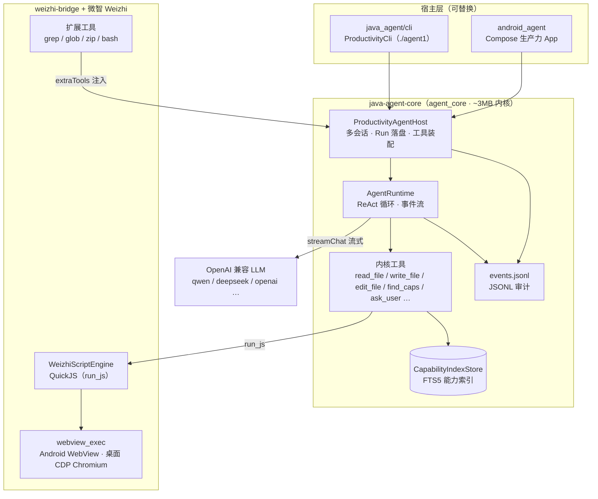
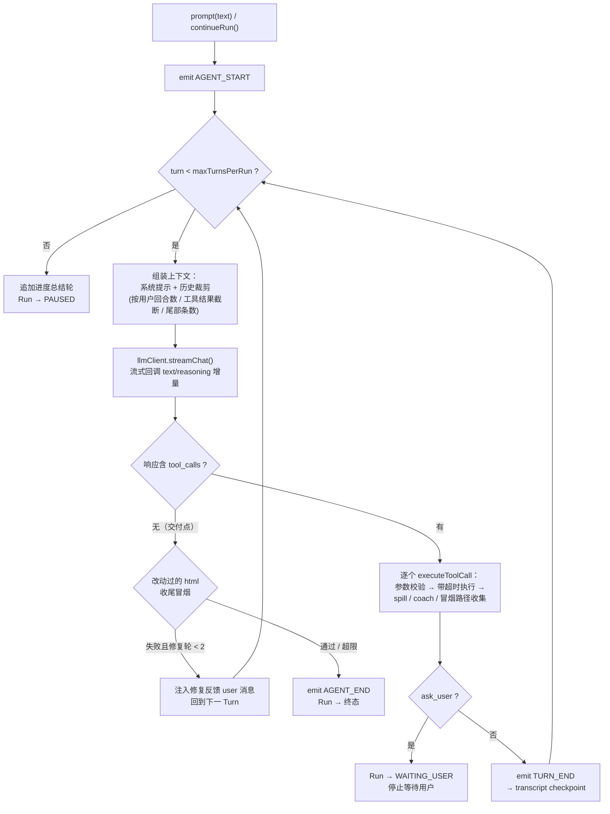
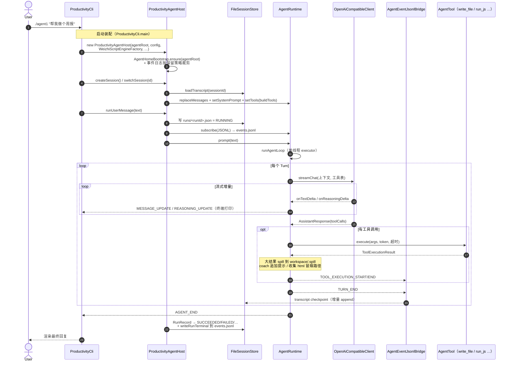
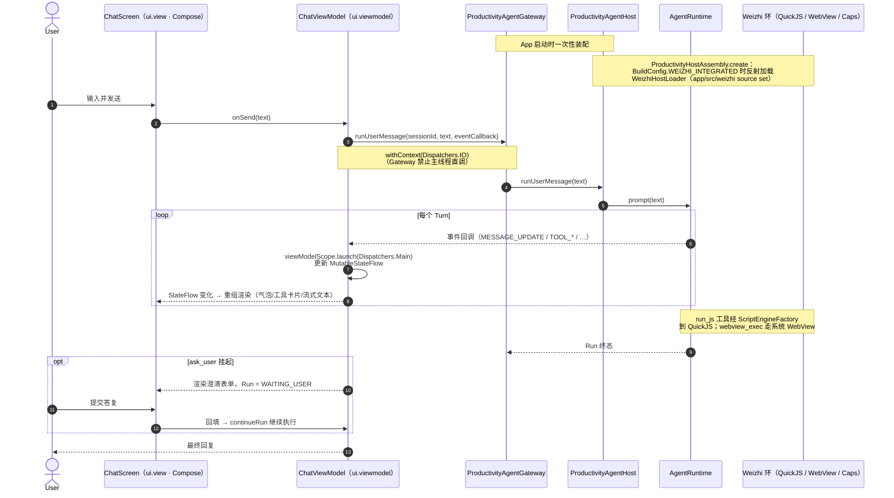
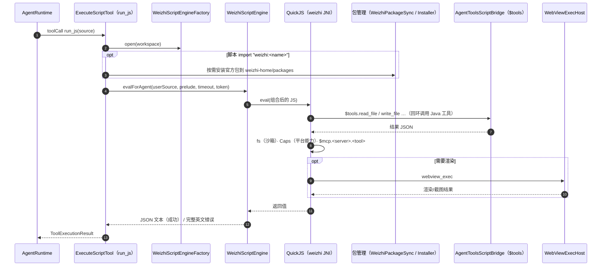
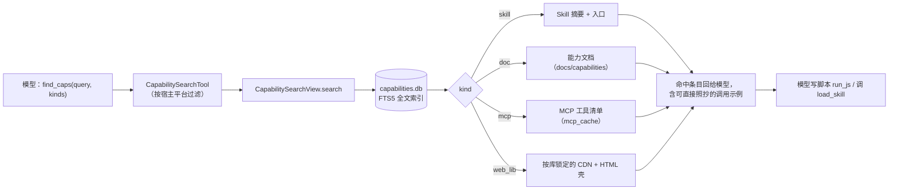
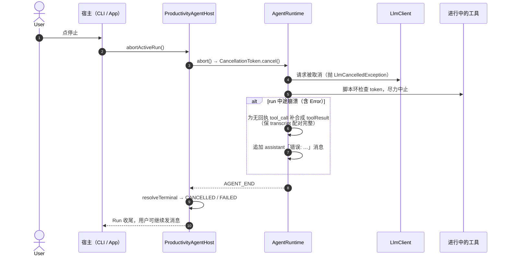

# Agent1 架构与主流程教程

> 目标读者：第一次接触本仓库、想在半小时内建立整体心智模型的开发者（或 AI 协作者）。
> 本文所有类名/路径均以当前代码为准；行为细节请以源码为最终依据。
> 相关阅读：[README](../README.md) · [微智 Weizhi 集成](集成/WEIZHI.md) · [运行时数据目录](../java_agent/doc/runtime-data-layout.md) · [自进化规划](规划/自进化Agent/README.md)

---

## 1. Agent1 是什么

Agent1 是一个**面向 Android / 嵌入式 JVM 宿主的轻量编程型生产力智能体**。一句话概括它的产品形态：

> 用户说人话 → 模型用少量「内核工具」读写工作区、检索能力 → 需要编排时写一段 **JavaScript**（`run_js`）交给 QuickJS 执行 → 全程事件落盘审计。

三个关键产品决策，理解了它们就理解了架构为什么长这样：

| 决策 | 含义 |
|------|------|
| **内核极小（~3MB）** | `agent_core` 只保留 ReAct 循环、会话、工作区沙箱、审计。其余能力靠检索（`find_caps`）按需发现，不把 API 手册塞进系统提示词 |
| **JS 优先** | 多步工作写成一段脚本（`run_js`），而不是一轮轮硬调几十个零散 Java 工具 |
| **宿主可换** | 内核不关心自己跑在哪：桌面 `./agent1` 与 Android App 共用同一份 `java-agent-core`，平台差异（WebView、文件、媒体）由宿主注入 |

---

## 2. 三层架构总览



要点：

- **宿主层**只做两件事：装配（`ProductivityHostAssembly` / `ProductivityCli.main`）和 UI/IO 适配。业务逻辑不写在宿主里。
- **内核**不依赖 Weizhi：没集成 Weizhi 也有工作区读写、`read_url`、`chat_history` 等内核工具，可以先接 UI 再补脚本环。
- **Weizhi 是外部项目**（`./sync-weizhi.sh` 拉到 `./weizhi`），提供 QuickJS 引擎、沙箱 `fs`、平台 Caps 和脚本内 MCP 客户端。`weizhi-bridge` 是本仓库侧的适配层。注意：`grep`/`glob`/`zip`/`bash` 这些**模型可见工具实现在 `agent_core`**，只是在集成 Weizhi 时经 `WeizhiWorkspaceTools` 注册进宿主；`load_skill` 则由宿主内核注册，按名读剧本及其内资源。

### 代码地图

| 路径 | 内容 |
|------|------|
| `agent_core/src/main/java/com/agent1/javaagent/` | 内核：`core/`（ReAct 运行时）、`session/`（宿主与持久化）、`tool/`（工具）、`capability/`（检索）、`event/`（事件）、`llm/`（模型客户端）、`script/`（脚本引擎抽象）、`log/`（审计）、`workspace/`（沙箱） |
| `java_agent/cli/` | `ProductivityCli`（推荐桌面入口）、经典 `JavaAgentCli`（开发辅助） |
| `java_agent/weizhi-bridge/` | `WeizhiScriptEngine(Factory)`、`WeizhiWorkspaceTools`、桌面 `DesktopWebViewExecTool` + CDP、`WeizhiPackageSync` |
| `android_agent/app/src/main/java/.../productivity/` | `ui.view`（Compose，无 IO）· `ui.viewmodel` · `logic.business`（纯逻辑）· `logic.data`（IO）；Weizhi 集成代码在独立 source set `app/src/weizhi/` |
| `doc/`、`docs/ai/` | 人类文档 / AI 契约 |

---

## 3. 核心概念词汇表

| 概念 | 是什么 | 落在哪 |
|------|--------|--------|
| **agentRoot** | 全部运行时数据根（会话、日志、能力索引、共享目录） | 桌面默认 `$HOME/files/agent`（`AGENT1_AGENT_ROOT` 可覆盖）；Android 为 App 私有目录 |
| **Session** | 一次持续对话；有独立 transcript 和工作区 | `sessions/<uuid>/` |
| **workspace** | 会话级**唯一可写沙箱**，路径校验由 `WorkspaceSandbox` 强制 | `sessions/<id>/workspace/` |
| **Run** | 一条用户消息触发的一次 ReAct 执行，有状态机 | `sessions/<id>/runs/<runId>.json` |
| **Turn** | Run 内的一轮「模型调用 + 工具执行」 | 内存中，`TURN_END` 时 checkpoint 到 transcript |
| **transcript** | 完整消息历史（user / assistant / toolResult），Run 结束/回合结束都落盘 | `sessions/<id>/transcript.jsonl` |
| **Event** | 运行时对外广播的进度事件（流式增量、工具开始/结束等） | 内存 RxJava 流 + 追加进 `logs/events.jsonl` |
| **能力（capability）** | 可被 `find_caps` 检索的条目：skill / 文档 / MCP 工具 / web_lib | `docs/capabilities/capabilities.db`（FTS5） |

Run 的终态（`RunState`）：`SUCCEEDED` / `FAILED` / `CANCELLED` / `PAUSED`（达到回合上限，自动追加进度总结后暂停）/ `WAITING_USER`（`ask_user` 挂起等用户答复）。

---

## 4. ReAct 主循环：AgentRuntime

ReAct 循环是整个系统的心脏，实现在 `agent_core/.../core/AgentRuntime.java`。`prompt()` 把用户消息追加进状态后在**单线程 executor** 上启动 `runAgentLoop()`：



几个值得注意的工程细节（都在 `AgentRuntime` 里）：

- **上下文组装**（`buildContextMessages()`，`AgentRuntime.java:637`）：系统提示词在前，历史消息依次过 `UserMessageTimestampAppender` → `ContextTurnLimiter`（按用户回合截断）→ `ToolResultTruncator`（截旧回合的大工具结果）→ `MessageHistoryLimiter`（尾部条数上限）。保证长会话不爆上下文。
- **工具执行隔离**：每个工具调用在 `ToolExecutorService` 上执行，有独立超时（工具可自报 `suggestedTimeoutMs`）；取消令牌 `CancellationToken` 贯穿 LLM 请求与工具执行。
- **transcript 完整性自愈**：run 中途崩溃（甚至 `Error` 级异常）时，`appendInterruptedToolResults()` 会为无回执的 `tool_call` 补合成 toolResult——否则之后每轮请求都会被服务端以「tool_call 无回执」拒绝。
- **HTML 收尾冒烟**：`write_file`/`edit_file` 写 html 时只收集路径；等模型不再调工具（交付点）才统一经 `webview_exec` 冒烟，失败注入修复反馈，最多 2 轮，防止「改坏→修复」死循环。

### 事件流

所有进度经 `emit()` 广播（`AgentRuntime.java:655`），一路走 RxJava `observeEvents()`，一路走 `AgentEventListener` 回调列表。事件的时序就是宿主渲染 UI 和写审计日志的依据：

```text
AGENT_START
└─ TURN_START
   ├─ MESSAGE_START
   │  ├─ MESSAGE_UPDATE …        (流式正文增量)
   │  ├─ REASONING_UPDATE …      (流式思考增量)
   │  └─ MESSAGE_END             (assistant 消息定稿)
   ├─ TOOL_EXECUTION_START
   │  ├─ TOOL_EXECUTION_UPDATE … (长任务进度，如脚本心跳)
   │  └─ TOOL_EXECUTION_END      (工具回执)
   └─ TURN_END
└─ AGENT_END / AGENT_ERROR
（另有 USAGE 事件携带 token 用量）
```

---

## 5. 主流程时序：一条用户消息的完整旅程

### 5.1 桌面 CLI（`./agent1 "帮我做个周报"`）



`runUserMessage()`（`ProductivityAgentHost.java:381`）是宿主侧的核心方法：建 Run 记录 → 订阅审计桥 → `runtime.prompt().join()` 同步等完 → `finally` 里统一收尾终态。每个 `TURN_END` 都会把新增消息 checkpoint 进 transcript，进程被杀也能恢复（下次发消息时 `recoverInterruptedRuns` 把孤儿 RUNNING Run 收成 FAILED）。

### 5.2 Android App



Android 侧的两条铁律（见 `.cursor/rules/android-layering.mdc`）：

1. **分层**：`ui.view` 不做 IO；IO 在 `logic.data`；`logic.business` 是纯逻辑。下层禁止依赖 `ui.*`。
2. **主线程 Gateway**：对内核的一切调用必须经 `ProductivityAgentGateway` 包一层 `Dispatchers.IO`，Compose 组合阶段直调会被静态检查拦下。

Weizhi 集成被隔离在独立 source set（`app/src/weizhi/`）：`ProductivityHostAssembly` 用 `BuildConfig.WEIZHI_INTEGRATED` + 反射加载 `WeizhiHostLoader`，让「不集成 Weizhi 也能编译出可用的极简 App」成为同一条主干路径。

---

## 6. 工具系统：模型能看到什么

工具装配发生在 `ProductivityAgentHost.buildTools()`（`ProductivityAgentHost.java:587`），**按会话**重建（工作区路径随会话变化）：

| 来源 | 工具 |
|------|------|
| 内核常驻 | `read_file` `write_file` `edit_file` `list_dir` `read_url` `chat_history` `ask_user` `todo_write` `find_caps` `load_skill`（统一优先级表 + registry 自动安装）`promote_request` `list_sessions` `media_resize` 等 media 工具 |
| 可选配置 | `web_search`（配置了 Tavily key 才注册） |
| Weizhi 扩展（`extraTools` = `WeizhiWorkspaceTools`） | `grep` `glob` `zip` `bash`（白名单）；桌面另有 `webview_exec`（Android 的 `webview_exec` 由 Weizhi 侧提供） |
| 脚本环（传了 `ScriptEngineFactory` 才有） | `run_js`（`ExecuteScriptTool`） |

实现方式有两种，模型看到的都是统一的 JSON Schema：

- 直接实现 `AgentTool` 接口（`read_file` 等）；
- `@Tool`/`@ToolParam` 注解 + `AnnotatedTools.from(...)`（`grep`/`zip`/`media` 等）。

系统提示词由 `ProductivitySystemPromptBuilder` 生成，只做**路由**，不做手册：身份 / 任务编排（先对照动态渲染的「官方 Skill 目录」，命中 `load_skill` 按剧本执行；未命中 `find_caps` + 一段 `run_js`）/ 环境状态 / 工具索引。细则各住一层：**怎么做**在 SKILL.md 剧本（`SkillCatalogSync` 渲染目录），**API 与引擎细则**在工具说明（如 `ExecuteScriptTool.DESCRIPTION`）与 `find_caps` 结果；环境段只报影响决策的信息（`HostEnvironmentProvider`：平台 / JS 运行环境 / 目录权限；内核、内存不报）。这就是「工具少而精，细节靠检索」在提示词层的落点。

---

## 7. 脚本链路：run_js → QuickJS

`run_js` 是主路径。内核只定义抽象（`agent_core/.../script/ScriptEngine.java`），实现由 `weizhi-bridge` 提供：



分层边界值得强调一遍：**模型可见工具（`run_js`、`grep`、`load_skill`…）是 Agent1 的 `@Tool`，实现在 `agent_core`；Weizhi 只提供引擎和脚本内 API**（`fs`、`$tools`、`$mcp`、Caps）。`$tools` 桥（`MutableScriptToolBridge`）让脚本可以回环调用当轮注册的全部 Java 工具，所以「用 JS 编排、用 Java 工具干活」是同一次执行里的事。

MCP 的接入方式也在这里：`agentRoot/mcp_servers.json` 配置 server → `McpCapabilitySync.ensureIndexed()` 把工具清单索引进 `find_caps` → 脚本内用 `$mcp.<server>.<tool>` 调用。**每个 MCP 工具不注册成 Java `@Tool`**，内核因此不随外部能力膨胀。

---

## 8. 能力检索：find_caps 与 Skill

「细节靠检索」的工作方式：



- 索引在 `agentRoot/docs/capabilities/capabilities.db`，种子来自 `agent_core` 的 `agent-home` 资源（`CapabilitySeedLoader`），启动 bootstrap 时建库。
- Skill 的加载与晋升形成闭环：`load_skill` 按统一优先级表（local → project → workspace → 宿主源如 assets → 已装 skills-home → catalog，全表未命中自动从官方 registry 安装）读 SKILL.md 或其内资源 → 运行中沉淀的可复用流程经 `promote_request` 提交审查 → 晋升到 `shared/local/skills/` 供后续所有会话检索。
- `web_lib` 条目给出「写 Markdown/Mermaid → 套 HTML 壳 → `write_file` 写 .html → 宿主自动冒烟预览」的出图路径。

---

## 9. 持久化与审计

### agentRoot 目录树（简化，详见 runtime-data-layout 文档）

```text
agentRoot/
├── agent.manifest.json          # 自省：schema 版本、阈值
├── sessions/<sessionId>/        # 每会话
│   ├── meta.json                #   标题、时间戳
│   ├── transcript.jsonl         #   完整消息历史（Run/回合结束追加）
│   ├── runs/<runId>.json        #   每次 Run 的状态机与统计
│   ├── todos.json               #   todo_write 任务清单
│   ├── session.summary.md       #   会话摘要
│   └── workspace/               #   ★ 会话唯一可写沙箱
│       ├── artifacts/           #     约定产出目录
│       └── .spill/              #     过大工具结果的 spill 文本
├── logs/events.jsonl            # 全局审计：run/model/tool/usage…
├── docs/capabilities/           # FTS5 索引 + 能力文档
├── shared/catalog/              # 远程目录安装产物（skills/scripts/libs/…）
├── shared/local/                # 晋升的自有 skill / 脚本
├── mcp_servers.json             # MCP server 配置
├── mcp_cache/                   # MCP 工具清单缓存
└── weizhi-home/                 # QuickJS home（官方包安装于此）
```

### 审计链路

`events.jsonl` 由 `AgentEventJsonlBridge` 写入：`runUserMessage()` 每次订阅一个桥实例，把事件流翻译成 JSONL 行，并在 Run 结束时补写终态行（`deferRunTerminal`）。启动时 `EventJsonlRetention.pruneOnStartup` 按保留策略裁剪。`./agent1 logs failed` / `logs summarize` 走 `log/query/EventLogQueryService` 读同一份文件。

---

## 10. 取消与异常：用户点「停止」之后发生什么



---

## 11. 把它串起来：一个典型任务的全景

以「帮我把这周的工作记录整理成一份带图表的周报」为例：

1. **装配**：App 启动 → `ProductivityHostAssembly` → （集成 Weizhi 时）`WeizhiHostLoader` 构造 `ProductivityAgentHost`，注册脚本引擎、`$tools` 桥、扩展工具、Android 平台实现（`BitmapImageResizer`、`AndroidMediaInspector`）。
2. **会话**：用户新建会话 → `FileSessionStore` 建目录 → `refreshRuntimeForActiveSession`：载 transcript、生成系统提示词（含环境摘要）、装配工具、挂沙箱、刷新 MCP 索引。
3. **Run**：用户发消息 → `runUserMessage` → `AgentRuntime` 进入 ReAct 循环。
4. **检索**：模型先 `find_caps("周报 图表")` 拿到 web_lib 壳与示例 → `read_file` 读工作记录。
5. **编排**：模型写一段 JS → `run_js` → QuickJS 执行，期间 `$tools` 回环读写文件，`webview_exec` 出图。
6. **交付**：`write_file` 写出 html → 收尾冒烟未过则注入反馈自动修复（≤2 轮）→ 无更多工具调用 → Run `SUCCEEDED`。
7. **沉淀**：transcript、runs、events.jsonl、会话摘要全部落盘；有复用价值的流程经 `promote_request` 晋升。

---

## 12. 上手路线建议

| 想理解… | 从哪读起 |
|---------|----------|
| ReAct 循环与事件 | `agent_core/.../core/AgentRuntime.java`（先读 `runAgentLoop` / `executeToolCall`） |
| 会话与 Run 持久化 | `agent_core/.../session/ProductivityAgentHost.java`（`runUserMessage` / `refreshRuntimeForActiveSession`） |
| 桌面装配 | `java_agent/cli/.../ProductivityCli.java` 的 `main` |
| 脚本环 | `agent_core/.../script/ScriptEngine.java` → `weizhi-bridge/.../WeizhiScriptEngine(Factory)` |
| Android 接入 | `ProductivityHostAssembly.kt` → `WeizhiHostLoader.kt` → `ProductivityAgentGateway.kt` → `ChatViewModel.kt` |
| 能力检索 | `agent_core/.../capability/CapabilitySearchView.java`、`tool/agent/CapabilitySearchTool.java` |
| 数据布局 | `java_agent/doc/runtime-data-layout.md` 与 `android_agent/doc/runtime-data-layout.md` |
